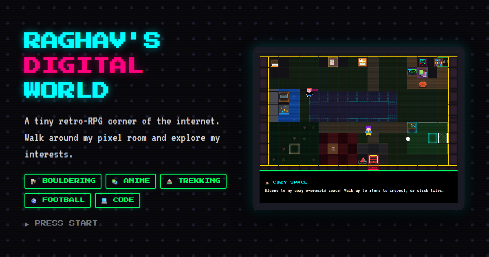
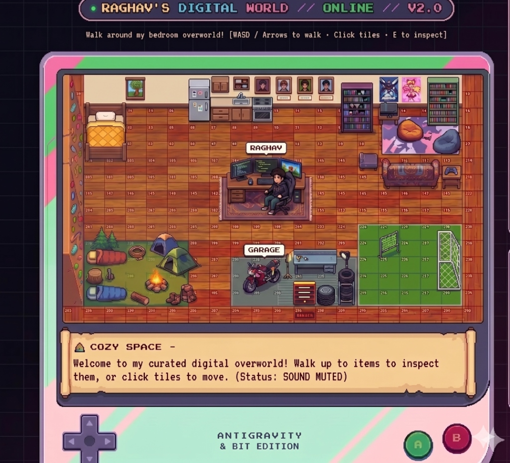

# 🏡 Raghav's Digital World

A tiny **retro-RPG corner of the internet** — a personal site shaped like a 16-bit handheld game.
Instead of a résumé, you walk a pixel avatar around a cozy bedroom overworld and discover my
interests by inspecting the things in the room: a bouldering wall, a manga pedestal, a travel
diary, a soccer pitch, a dev command-deck, and more.

Think *"about me"* meets *Stardew Valley* meets a Game Boy.



### 🎯 Final Design Goal (1:1 Reference Layout)



---

## ✨ Features

- **Character creator** — name your explorer, pick gender/hair, face style, skin tone, and outfit colors with a live animated sprite preview.
- **Top-down overworld** — smooth WASD/arrow movement, tile collision, and dynamic Y-sorting, all rendered inside a CRT-style handheld console.
- **Interactive landmarks** — every corner of the room reveals a slice of my life and gear.
- **Mini-games:**
  - 🧗 **Bouldering QTE** — a reflex climbing challenge on the gym wall.
  - ⚽ **1v1 Soccer** — score against a goalie/AI in a stadium overlay.
  - 🚲 **Bike race** — lap-time time-trials against an AI rider.
  - 🕹️ **Manga trivia arcade** — test your weeb lore for a streak badge.
- **RPG HUD** — live stats, energy bar, a quest log (main + side quests), equipped loot, and achievement badges.
- **Guestbook** — visitors can leave a retro review with their own custom sprite (saved in `localStorage`).
- **Juice** — chiptune Web-Audio SFX, scanlines, typewriter dialogue, and a secret cheat code.
- **Responsive** — plays on desktop and mobile; the on-screen console D-pad and A/B buttons drive everything on touch devices.

## 🎮 Controls

| Action | Key | Touch |
| --- | --- | --- |
| Move | `W A S D` / arrow keys | D-pad |
| Inspect / interact | `E` | `A` button |
| Close / back | `Esc` / `B` | `B` button |
| Secret cheat code | type `wwssadadba` | — |

## 🧰 Tech stack

- [React 19](https://react.dev/) + [Vite](https://vitejs.dev/)
- [Framer Motion](https://www.framer.com/motion/) for overlay/modal transitions
- Hand-rolled SVG pixel sprites & props (no sprite sheets)
- The Web Audio API for synthesized 8-bit sound effects

## 🚀 Getting started

```bash
npm install      # install dependencies
npm run dev      # start the dev server (http://localhost:5173)
npm run build    # production build → dist/
npm run preview  # preview the production build locally
```

## 📁 Project structure

```
index.html                  # entry, fonts, favicon, social/SEO meta
public/                     # static images + favicon + OG share card
src/
├─ main.jsx                 # React entry point
├─ App.jsx                  # console chassis, sidebar HUD, inspection modal
├─ index.css                # global retro styling + responsive rules
├─ mapConfig.js             # tilemap, collisions, and interactable objects
└─ components/
   ├─ InteractiveAvatar.jsx # the overworld engine + all mini-games
   ├─ GameStateContext.jsx  # shared game state (stats, quests, guestbook)
   ├─ RPGStats.jsx          # stats / quests / equips HUD panel
   ├─ Sprite.jsx            # directional SVG character sprite
   └─ PixelProp.jsx         # SVG furniture & decorative props
```

---

Built with caffeine and too many side-quests. Press Start. ▶
